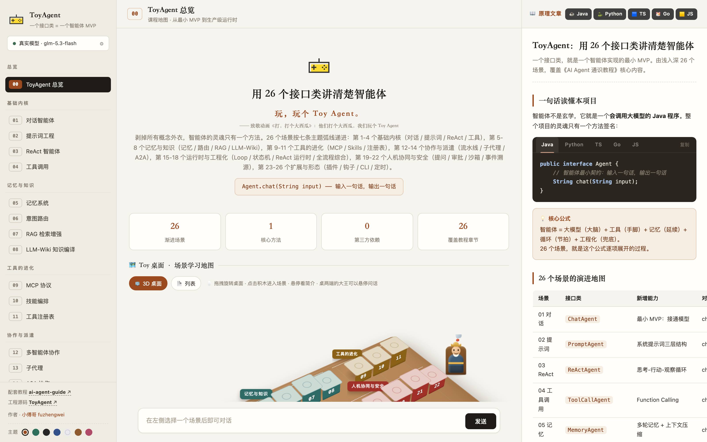
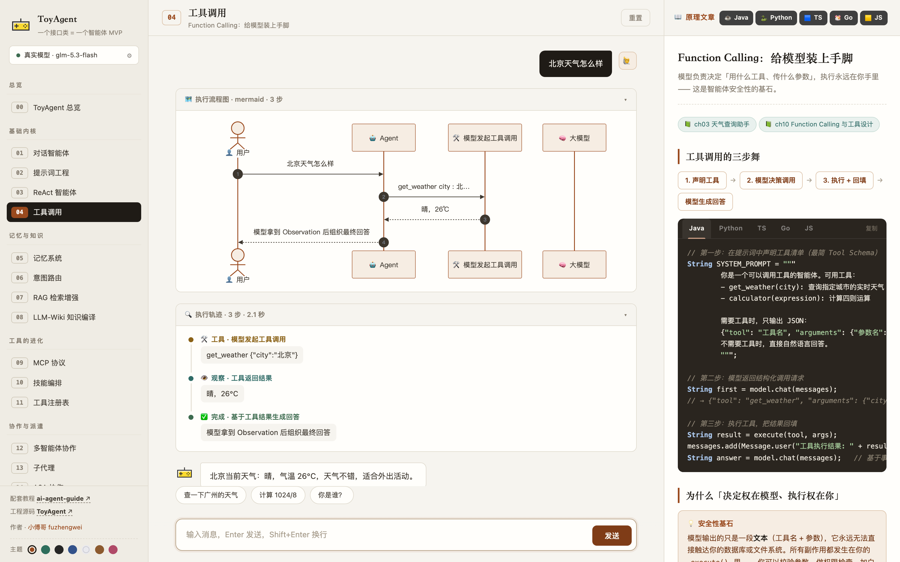
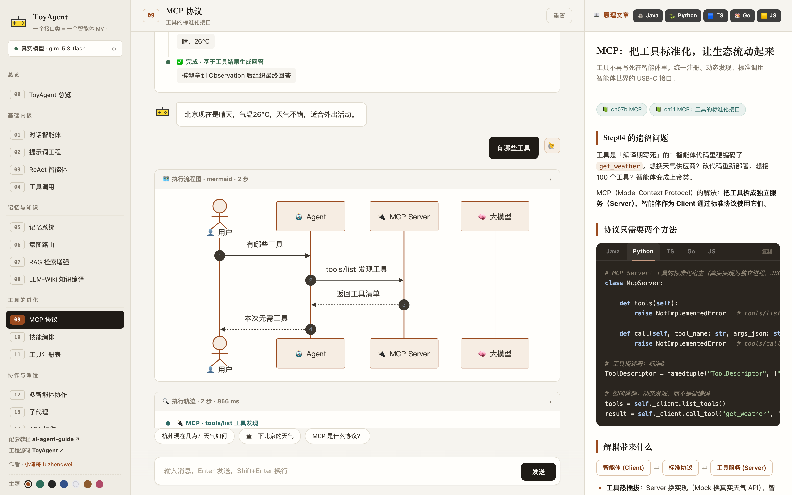

# ToyAgent

<div align="center">

**Agents explained in the simplest way possible — one interface class is a minimal viable agent**

[简体中文](README.md) · English · [日本語](README_JA.md)

Java 17 · Zero dependency · 26 progressive scenarios · Visual playground · 5 language implementations

</div>

Companion tutorial: [AI Agent Guide (Chinese)](https://github.com/fuzhengwei/ai-agent-guide) · Scenarios 15-22 reference [deepseek-harness-java](https://github.com/fuzhengwei/deepseek-harness-java)

## Screenshots

**Overview home**: scenario navigation grouped by seven theme arcs (left) · 3D learning map and stats (center) · principle articles (right)



**Scenario interaction**: chat + execution trace timeline + mermaid sequence diagram — every thought of the agent is visible



**Principle articles**: every chapter ships with a tutorial article whose code blocks switch between Java / Python / TS / Go / JS



## The Whole Idea in One Snippet

An agent has exactly one soul method:

```java
public interface Agent {
    String chat(String input);   // one sentence in, one sentence out
}
```

The 26 scenarios progress along seven theme arcs: core kernel (1-4) → memory & knowledge (5-8, incl. RAG and LLM-Wiki) → the evolution of tools (9-11) → collaboration & delegation (12-14) → runtime & engineering (15-18, #18 is the full-stack synthesis) → human-in-the-loop & safety (19-22) → extensions & shapes (23-26). Scenarios 15-22 reference deepseek-harness-java; 23-26 round out the plugin / hook / CLI / scheduling ecosystem.

## Multi-language Implementations

The same 26 scenarios and LLM layer are implemented equivalently in 5 languages, with per-scenario Mock teaching scripts aligned 1:1 — great for side-by-side reading:

| Language | Repository | Runtime | Notes |
|----------|------------|---------|-------|
| ☕ Java | **[ToyAgent](https://github.com/fuzhengwei/ToyAgent)** (this repo) | JDK 17+ | The original: 26 scenarios + visual web playground + HTTP API |
| 🐍 Python | [ToyAgent-Python](https://github.com/fuzhengwei/ToyAgent-Python) | Python 3.10+ | Standard library only, CLI runner |
| 🟦 TypeScript | [ToyAgent-Typescript](https://github.com/fuzhengwei/ToyAgent-Typescript) | Node 18+ | Zero runtime deps (devDeps: typescript only), strict mode |
| 🐹 Go | [ToyAgent-Go](https://github.com/fuzhengwei/ToyAgent-Go) | Go 1.22+ | Standard library only, single binary |
| 🟨 JavaScript | [ToyAgent-JS](https://github.com/fuzhengwei/ToyAgent-JS) | Node 18+ | Native ESM, no build step |

> The visual web playground lives only in the Java repo; the other language ports focus on the scenario code itself (`list` / `run` / REPL CLI modes) and serve as the source of the five-language code samples shown in the web articles.

## The 26 Scenarios

| # | Scenario | Class | New capability | Tutorial chapter |
|:---:|------|--------|----------|:---:|
| 01 | Chat agent | `ChatAgent` | Minimal MVP: wire up a model | ch01-03 |
| 02 | Prompt engineering | `PromptAgent` | Three-layer system prompt | ch04 |
| 03 | ReAct loop | `ReActAgent` | Thought-Action-Observation | ch04b/05 |
| 04 | Tool calling | `ToolCallAgent` | Function Calling | ch03/10 |
| 05 | Memory | `MemoryAgent` | Multi-turn memory + context compression | ch06 |
| 06 | Intent routing | `RouterAgent` | Intent recognition + decision hub | ch06b/07 |
| 09 | MCP protocol | `McpAgent` | Standardized tool interface | ch07b/11 |
| 10 | Skill orchestration | `SkillAgent` | Skills L0/L1/L2 | ch08/12 |
| 07 | RAG | `RagAgent` | Retrieval-augmented generation | ch16/20 |
| 12 | Multi-agent | `MultiAgent` | Planner-Executor-Reviewer collaboration | ch10/14 |
| 15 | Loop runtime | `LoopAgent` | Guards + fuse + fallback | ch08b/18/21 |
| 16 | Workflow state machine | `WorkflowAgent` | LangGraph-style orchestration | ch11b/15 |
| 18 | Full-stack agent | `FullAgent` | Guard+memory+ReAct+tools+fuse, end to end | Synthesis of 01-17 |
| 08 | LLM-Wiki knowledge compilation | `WikiAgent` | Compile knowledge once, persist, incrementally refine | ch13/26 |
| 11 | Tool registry | `RegistryAgent` | ToolDefinition protocol: register/discover/hot-dispose | dsh-java |
| 17 | ReAct runtime | `RuntimeAgent` | turn/step two-level loop + context trimming + TurnEndReason | dsh-java |
| 19 | Human intervention | `AskAgent` | ask_user_question: suspend → human answers → resume | dsh-java |
| 20 | Approval gate | `ApprovalAgent` | Risk levels + approval suspension + session exemption + deny-by-timeout | dsh-java |
| 21 | Sandbox defense in depth | `SandboxAgent` | Policy/blocklist/boundary/normalization, four interception layers | dsh-java |
| 22 | Event sourcing | `EventSourcedAgent` | Append-only JSONL event stream + replay projection | dsh-java |
| 23 | Plugin mechanism | `PluginAgent` | AgentPlugin contract + isolated ClassLoader + tool bridging | dsh-java |
| 25 | CLI agent | `CliAgent` | Terminal REPL + -p one-shot mode + sandboxed shell executor | ch18 |
| 13 | Subagents | `SubagentAgent` | dispatch_subagent: spawn fresh context / fork parent session | dsh-java |
| 24 | Hooks | `HooksAgent` | before intercept/rewrite · after redact/audit — attach and it works | dsh-java |
| 14 | A2A collaboration | `A2AAgent` | Agent Card discovery + task_id envelope + async receipt | dsh-java |
| 26 | Scheduling | `ScheduleAgent` | One-shot/recurring schedules, results appended to the event log | dsh-java |

One file per scenario under `src/main/java/cn/xiaofuge/ai/agent/stepXX/` — the interface comments are the tutorial, the nested implementation class is the entire logic.

## Quick Start

### Option 1: zero-dependency run (recommended, no Maven needed)

```bash
cd ToyAgent

# Compile (JDK 17+)
javac -encoding UTF-8 -d target/classes $(find src/main/java -name "*.java")

# Start (port 8099 by default, override with TOY_AGENT_PORT)
java -cp target/classes cn.xiaofuge.ai.Application
```

Open the playground: <http://localhost:8099>

### Option 2: Maven

```bash
mvn package
java -jar target/ToyAgent.jar
```

### Other languages

Each language repo's README has its own quick start (all clone-and-run, no packages to install):

```bash
# Python: python3 main.py run step03 "How is the weather in Beijing"
# TypeScript: npm run build && node dist/main.js run step03 "..."
# Go: go build -o toyagent && ./toyagent run step03 "..."
# JavaScript: node src/main.js run step03 "..."
```

### Hooking up a real LLM (optional)

Copy the config template and fill in any OpenAI-compatible API (DeepSeek, Qwen, Zhipu, Volcano Ark…):

```properties
# config.properties
base-url=https://api.deepseek.com/v1
api-key=sk-xxx
model=deepseek-chat
```

> Without a key, a built-in **Mock model** takes over: no network, no cost, and every scenario still shows its full execution trace (ReAct loops, tool calls, routing decisions, RAG retrieval…). Add a real key and the same skeleton gets a real brain. The Mock scripts are aligned per scenario across all five languages.

## Project Structure

```
ToyAgent/
├── pom.xml                              # cn.xiaofuge.ai:ToyAgent:1.0 (zero deps)
├── config.properties.example            # model config template
├── docs/images/                         # screenshots
├── web/                                 # playground (vanilla HTML/CSS/JS)
│   ├── index.html
│   ├── css/style.css                    # design tokens + 7 themes + 3-column layout
│   └── js/
│       ├── data.js                      # scenario metadata + sample prompts
│       ├── articles.js                  # 27 principle articles
│       ├── code-*.js                    # per-language code snippets (py/ts/go/js)
│       └── app.js                       # nav/chat/trace timeline/5-language code tabs
└── src/main/java/cn/xiaofuge/ai/
    ├── Application.java                 # HTTP server: static pages + API routes
    ├── llm/                             # model layer
    │   ├── ChatModel.java               # model abstraction (the brain)
    │   ├── OpenAiChatModel.java         # OpenAI-compatible client
    │   ├── MockChatModel.java           # teaching mock (26 scripts)
    │   ├── Models.java                  # config factory
    │   ├── Message.java                 # chat message record
    │   └── Json.java                    # zero-dep JSON codec
    └── agent/
        ├── Agent.java                   # the agent contract: chat(input)
        └── step01..step26/              # 26 scenarios, one interface class each
```

## HTTP API

| Method | Path | Description |
|--------|------|-------------|
| GET  | `/` | Playground page |
| GET  | `/api/config` | Current model mode (mock / real) |
| POST | `/api/{stepId}/chat` | Chat, body `{"message": "..."}` |
| POST | `/api/{stepId}/reset` | Reset scenario state (memory etc.) |

Response example:

```json
{
  "id": "step03",
  "name": "Step03 · ReAct agent (Thought-Action-Observation loop)",
  "answer": "Sunny in Beijing today, 26°C…",
  "trace": [
    {"type": "thought", "label": "Thought 1", "detail": "Need the weather tool"},
    {"type": "action", "label": "Action 1", "detail": "get_weather(Beijing)"},
    {"type": "observation", "label": "Observation 1", "detail": "Sunny, 26°C"},
    {"type": "final", "label": "Final Answer", "detail": "..."}
  ],
  "ms": 86
}
```

## Design Principles

1. **One interface class = one agent MVP** — no framework magic; every line of logic is visible and touchable;
2. **Zero dependencies** — only JDK built-ins (`com.sun.net.httpserver` + `java.net.http`), hand-written JSON codec, clone and run;
3. **Progressive depth** — 26 scenarios strictly ordered along seven theme arcs; each scenario adds exactly one capability; the sidebar grouping is the learning map and the interface comments are the tutorial;
4. **The page is the test** — vanilla HTML/CSS/JS three-column layout: scenario navigation, chat + trace timeline + mermaid diagrams, and principle articles with five-language code tabs;
5. **Mock / real dual mode** — skeleton and brain are separated: learn with the Mock while watching traces, then swap in a real model with a key;
6. **Equivalent multi-language implementations** — one teaching narrative, aligned per scenario across 5 languages; pick whichever language you like and understand what an agent really is.

## License

Apache-2.0 © Xiaofuge (小傅哥)
