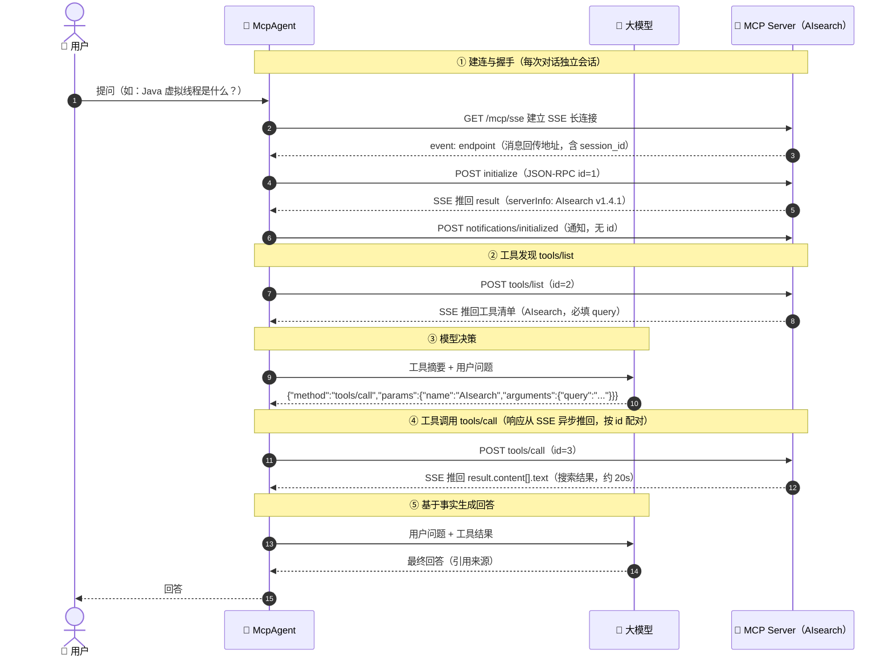

# Step09 · MCP 对话时序图

> 对应场景：`step09`（教学版 MCP）与 `step09-real`（真实对接百度 AI 搜索 MCP Server）。
> 两者 Agent 流程完全一致，区别只在传输层：教学版是进程内接口直调，真实对接是 JSON-RPC 2.0 over HTTP+SSE。
> 下图按真实对接绘制，教学版只需把「SSE 长连接」理解为方法调用即可。

## 关键点

1. **两条通道**：请求走 `POST /mcp/messages?session_id=...`，响应从 SSE 长连接异步推回，靠 JSON-RPC `id` 配对（`ConcurrentHashMap<id, 响应>` + `CountDownLatch` 等待）。
2. **工具发现是动态的**：工具清单来自 `tools/list` 的真实返回，不硬编码在智能体里。
3. **Agent 骨架零改动**：把教学版的 `McpClient` 换成 `SseMcpClient`，决策、调用、总结的代码一行不变——这正是 MCP 解耦的价值。
4. **相关源码**：`src/main/java/cn/xiaofuge/ai/agent/step09/McpRealAgent.java`
