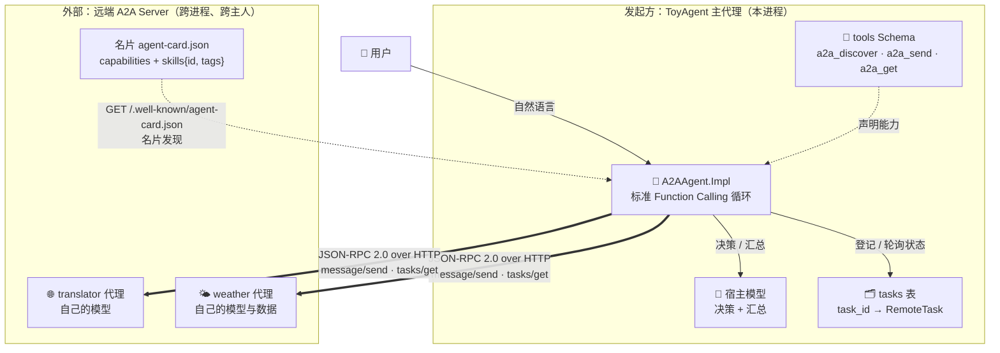
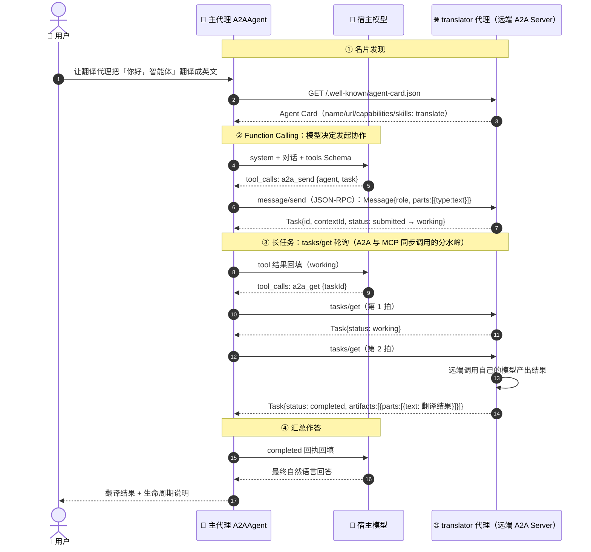
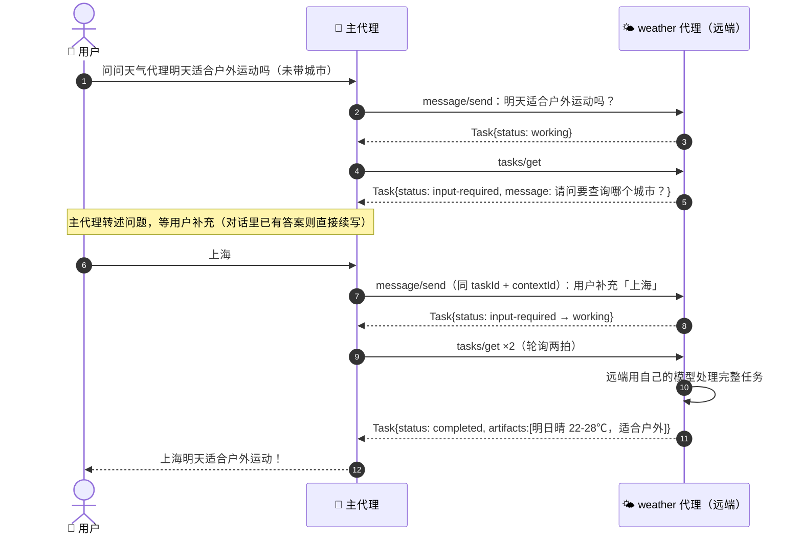

# Step14 · A2A 协作：架构与时序

> 线格式按真实 A2A 规范（Google 发起、现属 Linux Foundation）绘制：JSON-RPC 2.0 over HTTP、
> Agent Card 发现、Task 生命周期、input-required 多轮。ToyAgent 把「网络请求」换成方法调用，
> 状态机与信封结构完全一致。

## 一、架构图

Step13 的子代理是**自家分身**（同进程、共享宿主模型）；Step14 的 A2A 是**外部同行**：
对方是跨进程的完整 Agent，有自己的模型与工具，发起方只认 `task_id` 与标准化信封。

关键认知：**MCP 给模型接工具，A2A 让代理委派代理**——两者互补。A2A 的对方不是函数，
而是「有自己的大脑、按 Task 生命周期干活」的完整 Agent。

## 二、时序图 ①：名片发现 + 标准任务生命周期（translator）

## 三、时序图 ②：input-required 多轮协作（weather · 人在回路）

对方信息不够时不是失败，而是停进 `input-required` 提问；客户端带**同一 task_id + contextId**
续发消息，任务接着跑。

## 四、关键点

1. **派遣即工具**：`a2a_discover` / `a2a_send` / `a2a_get` 以 tools Schema 声明（与 Step04/13
   同一协议），模型返回结构化 `tool_calls`，不再从自由文本猜 JSON。
2. **异步轮询是 A2A 的灵魂**：发起方拿到 `task_id` 即可离开，用 `tasks/get` 轮询或 SSE 流式
   订阅等结果——真实生产里还有 webhook push notification。这正是它与 MCP 同步 `tools/call`
   的本质区别。
3. **信封标准化**：请求是 `Message{role, parts[]}`，回执是 `Task{id, contextId, status, artifacts[]}`。
   发起方只认 task_id，不关心对方用什么框架、什么模型。
4. **input-required 支撑人在回路**：对方缺信息时停下提问，同一任务多轮续写——不是新任务，
   context 不断。
5. **远端有自己的大脑**：`runRemotely()` 让远端代理真调一次自己的模型，而不是宿主代写答案。
6. **防泄密与 Step13 同源**：上下文隔离靠协议边界（只传 task 描述），对方永远看不到发起方的
   会话历史。

### 三种协作形态对比

| 维度 | Step13 子代理 | Step14 A2A | MCP 工具 |
|------|--------------|------------|----------|
| 关系 | 自家分身 | 外部同行（跨主人） | 工具提供方 |
| 位置 | 同进程 | 跨进程/跨网络 | 进程内或独立 Server |
| 发现 | 代码里 CHILDREN 常量 | Agent Card（well-known URI） | tools/list |
| 调用 | dispatch_subagent 工具 | message/send + tasks/get | tools/call |
| 节奏 | 同步（进程内） | 长任务、可轮询/流式 | 同步（或流式） |
| 上下文 | fork 可继承父会话 | 对方独立，只认 task_id | 无状态单次调用 |

## 六、相关源码

- 场景实现：`src/main/java/cn/xiaofuge/ai/agent/step14/A2AAgent.java`
- Mock 剧本：`src/main/java/cn/xiaofuge/ai/llm/MockChatModel.java`（`mockA2aToolCall` + 远端子剧本）
- 对照场景：`step13/SubagentAgent.java`（进程内子代理）、`step09/McpAgent.java`（MCP 工具协议）
