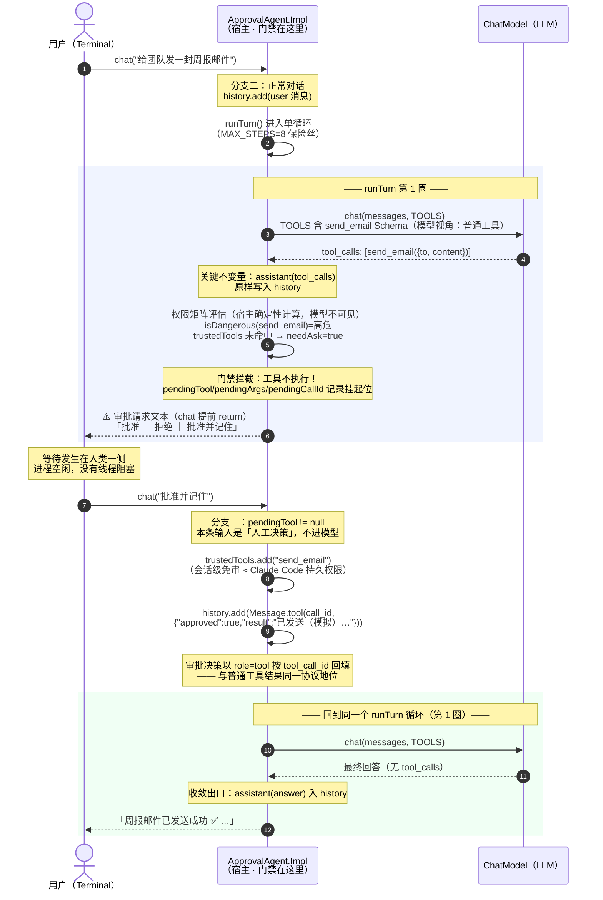
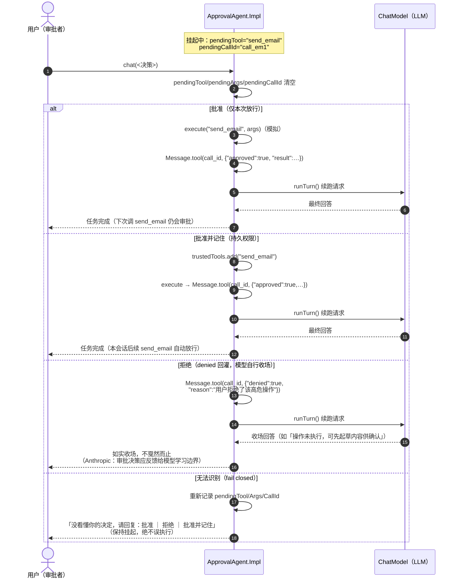
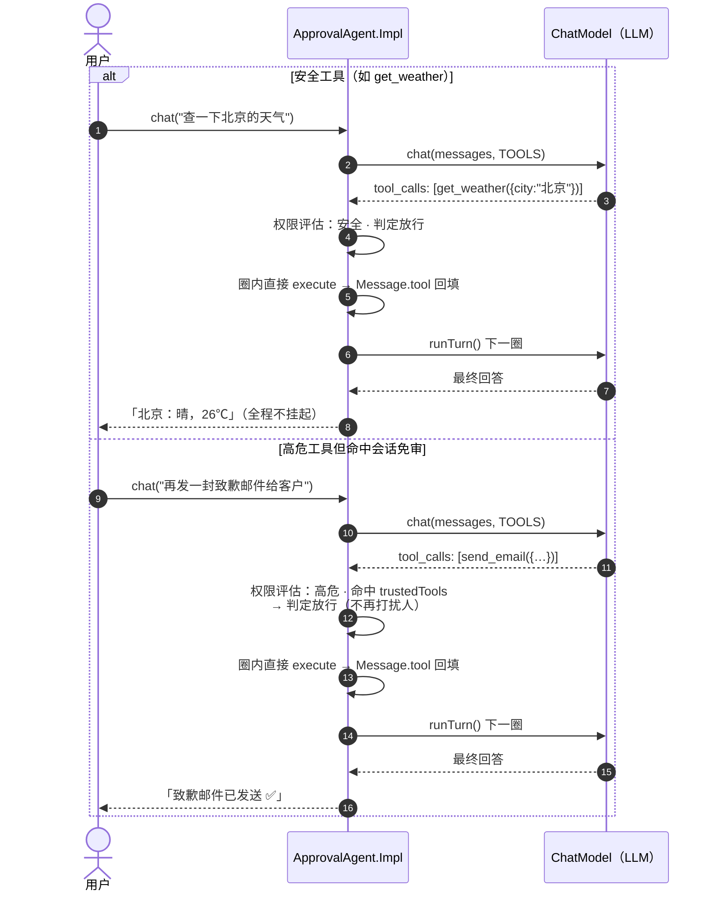

# Step20 · 审批门禁 —— 时序图

> 对应实现：`ApprovalAgent.java`（原生 Function Calling + 宿主审批门禁）
> 核心结论先记住：**审批不是工具，是宿主插在「工具调用 → 执行」之间的确定性拦截**；
> 挂起 = `chat()` 提前 return + 一个非 null 的 `pendingTool` 字段，**等待发生在人类一侧，进程里没有任何东西在等**。

## 图 1 · 主时序：高危工具 → 门禁挂起 → 人工决策 → 回填续跑

场景：用户请求发周报邮件（高危操作 send_email），走「挂起 → 批准并记住 → 续跑完成」全流程。

## 图 2 · 三种人工决策的分岔（分支一内部）

## 图 3 · 对照：安全工具直通 & 免审命中（不挂起的两条路）

## 读图要点（讲解用）

| 要点 | 图上位置 | 说明 |
|---|---|---|
| 单循环 | 两处 `runTurn` 矩形 | 挂起前后是**同一个循环**：决策回填后从第 1 圈重新开始，与 ToyHarness `runLoop` / step19 `runTurn` 同构 |
| 门禁在宿主侧 | `权限矩阵评估` 自环 | 模型只看到普通工具清单，判定 `needAsk` 是确定性代码（isDangerous + Mode + trustedTools），模型不可见、不可绕过 |
| 挂起的本质 | 图 1 第 7 步 | `chat()` 提前 return + `pendingTool != null`；下一条消息改道成「人工决策」，**没有任何线程在等** |
| role=tool 回填 | `Message.tool(call_id, …)` | 批准结果 / denied 都是工具结果，与 get_weather 的结果同一协议地位 |
| 拒绝也是反馈 | 图 2 alt 拒绝 | denied 回灌进推理轨迹，模型可调整方案——审批决策反馈给模型学习边界 |
| fail closed | 图 2 alt 无法识别 | 决策不明 → 保持挂起，宁可不动，不可乱执行（生产版超时同样按 DENY） |

与 step19 的对照：两图形状几乎相同（单循环 + 挂起退出 + role=tool 回填），唯一差别是**谁决定挂起**——step19 是模型主动调 `ask_user_question`（问人是能力，工具化）；step20 是宿主规则拦下高危调用（拦人是权力，门禁化）。

## 参考来源（Anthropic 官网）

| 文章 | 链接 | 对应本图的观点 |
|---|---|---|
| Building Effective Agents（2024-12，Erik Schluntz & Barry Zhang） | anthropic.com/engineering/building-effective-agents | 「Agents can then pause for human feedback at checkpoints or when encountering blockers.」——checkpoint 即挂起点；「stopping conditions (such as a maximum number of iterations)」即 MAX_STEPS 保险丝 |
| Our framework for developing safe and trustworthy agents | anthropic.com/news/our-framework-for-developing-safe-and-trustworthy-agents | 人类保持控制权；Claude Code 默认只读、修改类动作须审批、可授予持久权限（对应「批准并记住」） |
| Trustworthy agents in practice | anthropic.com/research/trustworthy-agents | 每个工具可配置 always allow / needs approval / block（对应权限矩阵 + 免审名单） |
| How we contain Claude across products | anthropic.com/engineering/how-we-contain-claude | 逐次审批是「概率性监督」（93% 审批疲劳数据），容器化才是确定性边界——门禁须配合沙箱纵深防御 |

注：「审批决策回灌让模型学习边界」的表述源自社区对 Claude Code 行为的归纳（拒绝时以 tool_result 告知模型并令其停手），官网原文措辞见上表第 1、4 篇。
